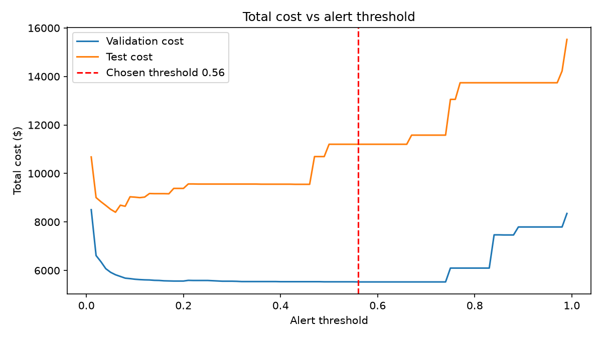
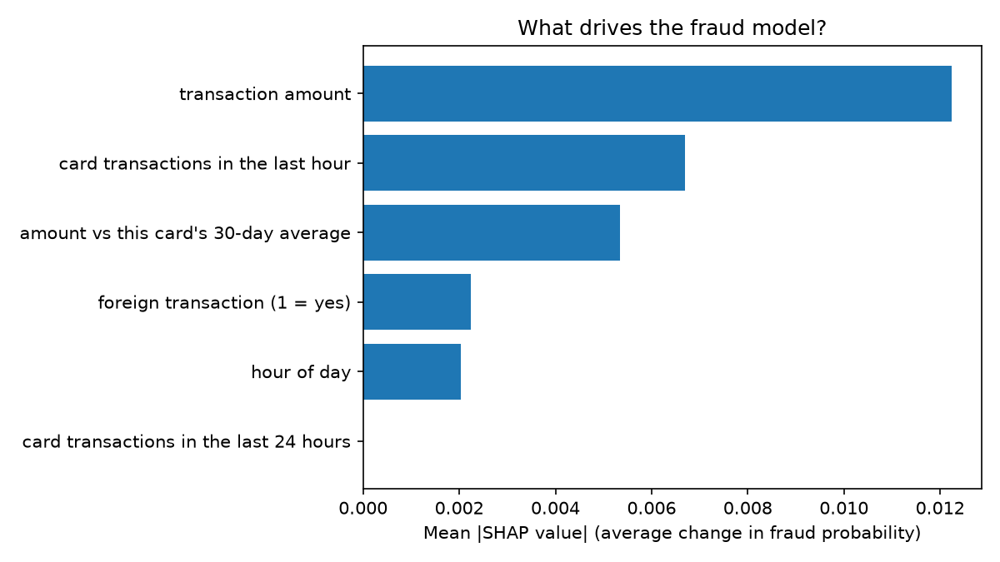
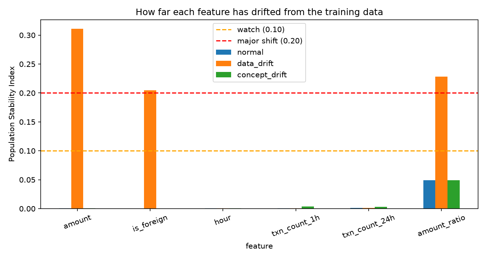

# FraudSense: End-to-End Fraud Detection and Investigation

[](https://github.com/Yukesh-18/fraudsense-ml-pipeline/actions/workflows/ci.yml)

FraudSense scores card transactions for fraud, explains each alert, finds the matching policy rules and similar past cases, watches itself for drift, and shows everything in a web dashboard. It runs locally with Python, SQLite, Flask and Streamlit on **synthetic data** (50,256 transactions, 0.85% fraud).

## What it does

- **SQL feature layer:** window functions compute card velocity (uses in the last hour and 24 hours) and spend versus the card's 30-day average, looking only at the past.
- **Model benchmark:** six classical models plus a PyTorch neural network, compared on a time-based split.
- **Cost-based alerting:** a transaction is flagged when fraud probability x amount is above the review cost, not by a fixed score cutoff.
- **Explanations:** exact SHAP values with a built-in check that the contributions add up to the score.
- **Experiment tracking:** MLflow records three boosted-tree runs; the winner on validation data is saved as the production model.
- **API:** Flask service with `/health`, `/score` and `/score/<id>`, logging every prediction to the database.
- **Investigator:** combines the score, the SHAP reasons and a TF-IDF search over policy and past cases into a case report with a rule-based recommendation.
- **AI summary:** a LangChain agent backed by a local model (Ollama) can write the case summary or answer questions with five tools, including read-only SQL.
- **Drift monitoring ("ModelDoctor"):** scipy tests and PSI check three simulated futures and diagnose data drift versus concept drift.
- **Dashboard:** Streamlit app with overview charts, an alert queue, live scoring, model results and model health.
- **Tests and CI:** 10 pytest checks, a Dockerfile and a GitHub Actions workflow that runs the pipeline and tests on every push.

## Results

Benchmark on the test set (105 fraud cases out of 10,051 transactions):

| Model | PR-AUC | ROC-AUC | Precision | Recall |
| --- | --- | --- | --- | --- |
| PyTorch MLP | 0.634 | 0.898 | 0.722 | 0.543 |
| Gradient Boosting | 0.609 | 0.886 | 0.948 | 0.524 |
| Logistic Regression | 0.601 | 0.895 | 0.090 | 0.771 |
| SVM (linear) | 0.594 | 0.896 | 0.100 | 0.752 |
| kNN | 0.581 | 0.826 | 1.000 | 0.438 |
| Random Forest | 0.572 | 0.850 | 0.980 | 0.467 |
| Decision Tree | 0.531 | 0.802 | 0.066 | 0.714 |

A model that flags nothing scores about 0.01 PR-AUC. With only 105 fraud cases, gaps of about 0.02 are within noise.

Total cost on the test period, assuming a $5 review cost per alert and that a missed fraud costs its full amount:

| Strategy | Total cost |
| --- | --- |
| No model | $37,484.42 |
| Flag everything | $50,255.00 |
| Fixed threshold 0.56 | $11,203.74 |
| Expected-loss rule (production model) | $3,904.40 |

The expected-loss rule is 89.6% cheaper than flagging nothing.

Drift monitoring on three simulated futures:

| Scenario | Status | PR-AUC change | Fraud caught | Savings vs no model |
| --- | --- | --- | --- | --- |
| Nothing changed | HEALTHY | 0% | 66 / 105 | 90% |
| Prices inflate, more foreign purchases | WATCH | -10% | 71 / 105 | 90% |
| Fraudsters stop using bursts | DEGRADED | -38% | 57 / 105 | 84% |

In the last scenario the overall feature drift is tiny (max PSI 0.05), because fraud is about 1% of traffic. Only the performance check and the fraud-rows-only check catch it.

A linear-regression "spend surprise" feature was tested and added nothing: PR-AUC 0.617 without it and 0.616 with it, averaged over five seeds. The regression's R-squared was -0.004, because amounts in the synthetic data are independent of the card.





## Architecture

1. `generate_data.py` creates synthetic transactions with hidden fraud bursts.
2. `build_db.py` loads them into SQLite and `sql/features.sql` builds the features.
3. Training scripts read the features and split by time into train, validation and test.
4. `train_final.py` tracks runs in MLflow and saves `models/fraud_model.joblib`.
5. `api.py` serves the model and logs predictions.
6. `investigate.py` calls the API, adds SHAP reasons, searches `docs/` and writes a report.
7. `agent.py` lets a local model write the summary or answer questions with tools.
8. `monitor.py` compares simulated futures with the training data and diagnoses drift.
9. `dashboard.py` shows it all.

## Project structure

```
fraudsense/
  .github/workflows/   CI: pipeline, tests, Docker build
  assets/              screenshots and charts for this README
  docs/                sample policy and case notes (fictional)
  scripts/             container start script
  sql/                 features.sql
  src/                 all scripts
  tests/               pytest checks
  Dockerfile, docker-compose.yml, requirements*.txt
  data/, models/, reports/   generated (not in git)
```

## Quickstart (Windows PowerShell)

```powershell
python -m venv venv
.\venv\Scripts\Activate.ps1
pip install -r requirements.txt

py src/generate_data.py
py src/build_db.py
py src/train_baselines.py
py src/train_nn.py
py src/threshold_cost.py
py src/explain_shap.py
py src/train_final.py
py src/make_docs.py
py src/monitor.py
py src/spend_model.py
```

Start the API in one terminal and leave it running:

```powershell
py src/api.py
```

In a second terminal:

```powershell
py src/test_api.py
py src/investigate.py 48612
streamlit run src/dashboard.py
mlflow ui --backend-store-uri sqlite:///mlflow.db
py -m pytest -q
```

Run every command from the main folder, not from inside `src`. On Windows, PyTorch needs the Microsoft Visual C++ Redistributable.

### Optional: the AI summary

Install [Ollama](https://ollama.com/download), pull a model, and run the agent with the API running:

```powershell
ollama pull llama3.2
py src/agent.py report 48612
py src/agent.py chat "How many fraud cases are in the database?"
```

Set `OLLAMA_MODEL` to use another model. Small models can misread details or refuse: in testing, a 3B model gave a good summary, and a 1B model refused the task once. The rule-based report is always the verified source, and the AI summary is labelled as AI-written.

### Optional: Docker

```powershell
docker compose up
```

The first start builds the data and the model, then serves the dashboard at http://localhost:8501.

## Limitations

- The data is synthetic and the fraud bursts are unrealistically easy to spot: about 0% fraud with no earlier use in the hour, about 97% with two.
- The test set has only 105 fraud cases, so small score gaps are noise.
- Isolated single-transaction fraud is the hard part. Recall stays near 50% where precision is high.
- Drift scenarios are simulated, and two detection thresholds were tuned after seeing them, so real drift will be messier.
- The investigator's recommendation is rule-based. Retrieval uses TF-IDF keyword matching, not embeddings.
- The $5 review cost is an assumption, and the cost model ignores customer inconvenience.
- The policy and case documents in `docs/` are fictional samples.
- The database is SQLite, not a production database server.

## Roadmap

- Replace TF-IDF with embedding-based retrieval
- Try real or more realistic transaction data
- Automatic retraining when the ModelDoctor reports DEGRADED
- PostgreSQL instead of SQLite
